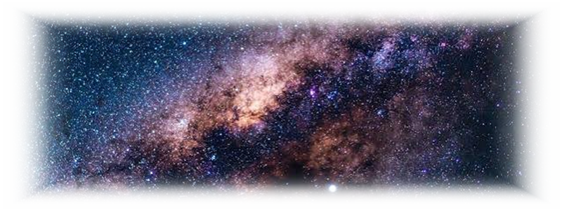

  <picture>
    <source media="(prefers-color-scheme: dark)" srcset="banner-dark.png">
    <source media="(prefers-color-scheme: light)" srcset="banner-light.png">
    
  </picture>

  

  

---

### 🌟 About Me

👋 Hello! I am **Madhav Raj Modi**.

* 🎂 **Age:** 11 years old
* 💻 **What I'm doing:** I am studying coding and learning how to build software
* 🔬 **My Dream:** I want to become a **Scientist** and discover new things to help the world
* 🚀 **Passions:** Science, Technology, and Problem Solving

---

### 🔭 What I Love & Explore

* 🧪 **Science & Discovery:** Curious about how the universe, nature, and technology work
* 💻 **Coding:** Learning logic, programming fundamentals, and computer science
* 📚 **Learning:** Reading, experimenting, and trying out new ideas every day

---

### 📊 My GitHub Journey

  
  

---

  ✨ <i>"Somewhere, something incredible is waiting to be known."</i> – Carl Sagan

